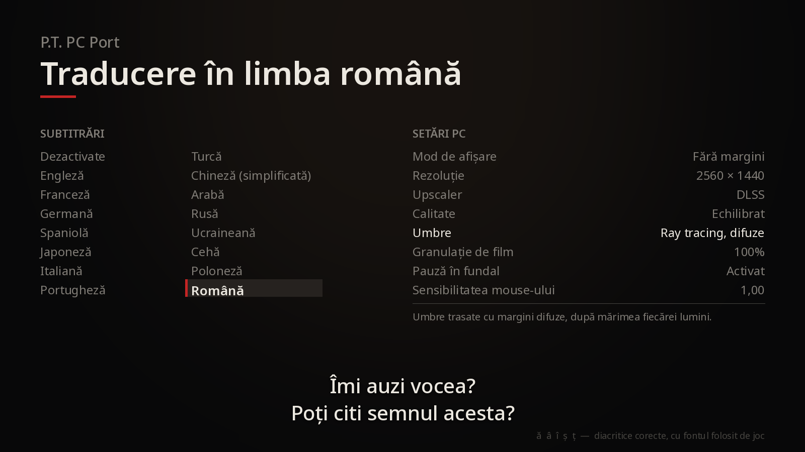

Textele traducerii, afișate cu fontul pe care îl folosește jocul.

# P.T. pe PC, acum în limba română 🇷🇴

Traducere completă în română pentru **[P.T. PC Port](https://github.com/LoreanXavier/pt-pc)**, portul nativ pentru PC al lui P.T. făcut de LoreanXavier. Toate textele sunt cu diacritice corecte: **ă, â, î, ș, ț**.

## Ce este tradus

- **Toate subtitrările**: știrile de la radio, predica, apelul telefonic, punga care vorbește, vocea de după ușă și toate celelalte replici
- **Ecranul de opțiuni** al jocului (luminozitate, subtitrări, cameră)
- **Setările PC** în întregime: afișare, grafică, ray tracing, upscaling, sunet, control, microfon
- **Extra**: selectorul de bucle, Muzeul, modul foto, camera liberă, cronometrul de speedrun, VR
- Mesajele de eroare, explicațiile fiecărei setări și genericul portului

Vocile rămân cele originale, în engleză, ca în toate celelalte traduceri ale portului. Cuvântul pe care îl asculți la microfon rămâne „Jack”.

## Instalare

**1. Instalează jocul din proiectul original**

Descarcă și instalează **P.T. PC Port** de aici:
👉 **https://github.com/LoreanXavier/pt-pc/releases**

Urmează instrucțiunile de acolo. Ai nevoie de copia ta de P.T. de pe PS4. Pornește jocul o dată ca să verifici că merge.

**2. Descarcă traducerea**

Descarcă din **Releases** traducerea:
👉 **https://github.com/VonMitza/pt-pc-romanian/releases**

**3. Pune traducerea peste joc**

1. Deschide folderul jocului. Implicit e `%LocalAppData%\Programs\P.T. PC Port` (poți lipi calea direct în bara de adrese din Explorer).
2. Redenumește `pt.exe` existent în **`pt.exe.original`**, ca să-l ai ca rezervă.
3. Copiază `pt.exe` din arhiva traducerii în folderul jocului.

**4. Alege limba română**

Pornește jocul și mergi la **Opțiuni → Subtitrări → Română** (ultima din coloana a doua). Dacă Windows-ul tău e în română, jocul o alege singur la prima pornire.

Salvările și setările tale (folderul `data`) rămân neatinse.

## Bine de știut

- **Doar pentru Windows** (10 sau 11, 64-bit).
- **Doar pentru versiunea 1.0.3.** Când apare o versiune nouă a portului, instalează-o din proiectul original și așteaptă traducerea actualizată de aici. Un `pt.exe` vechi peste un joc nou (sau invers) poate să nu pornească.
- **Dezinstalare:** șterge `pt.exe` și redenumește `pt.exe.original` înapoi în `pt.exe`, sau reinstalează jocul din proiectul original.
- Windows SmartScreen poate avertiza că fișierul nu e semnat. E normal pentru un `pt.exe` compilat de comunitate. Fișierul e compilat public, de GitHub, iar amprenta lui apare în descrierea Release-ului.

## Detalii tehnice

- Compilat automat de GitHub Actions din codul oficial al portului, versiunea `v1.0.3`, cu traducerea aplicată peste.
- Amprenta SHA-256 a fiecărui `pt.exe` se află în descrierea Release-ului.
- Toate textele traducerii sunt în [`traducere/romanian_text.h`](traducere/romanian_text.h). Restul modificărilor (româna adăugată în lista de limbi) sunt în [`traducere/romana-1.0.3.patch`](traducere/romana-1.0.3.patch).

## Mulțumiri

**LoreanXavier**, pentru portul P.T. pe PC. Dacă îți place jocul pe PC, susține-l: [patreon.com/loreanxavier](https://www.patreon.com/loreanxavier).

P.T. este proprietatea Konami Digital Entertainment și Kojima Productions. Nici portul, nici traducerea nu sunt afiliate cu Konami sau Kojima Productions. Nu conțin fișiere ale jocului și nu funcționează fără copia ta de P.T.

---
Traducere în limba română: **VonMitza**. Ai găsit o greșeală sau o formulare ciudată? [Deschide un issue](https://github.com/VonMitza/pt-pc-romanian/issues).
